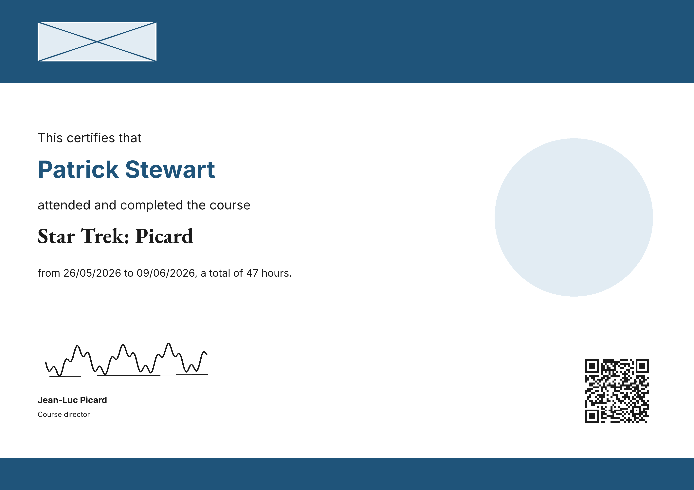

---
myst:
  html_meta:
    "description": "Tutorial: design a certificate template with the designer, preview it, and create your first certificate."
    "property=og:description": "Tutorial: design a certificate template with the designer, preview it, and create your first certificate."
    "property=og:title": "Your first certificate template"
    "keywords": "Plone, Attendance Certificates for Plone, tutorial, designer, template"
---

(tutorial-first-template)=

# Your first certificate template

In this tutorial you will design a {term}`certificate template` over a background image, preview it, and create a {term}`certificate` from it.
You will need a running Plone site with the add-on installed, and the Volto frontend.
You also need a user who may add templates and certificates, which the install guide explains how to grant.
If you have not set those up yet, follow [install](../how-to-guides/install.md) first.

By the end you will have a template that prints a name, an event, two dates, the hours and a QR code, and one issued certificate.

## 1. Start the development environment

From the root of the repository, install and start the backend and the frontend, each in its own terminal:

```shell
make install
make backend-start
```

```shell
make frontend-start
```

The backend runs on `http://localhost:8080` and the frontend on its own port.
The `install` target creates a Plone site, which you can open at `http://localhost:8080/Plone` after logging in.
<!-- source: Makefile -->
<!-- source: backend/Makefile -->
<!-- source: frontend/package.json -->

## 2. Create a folder for the certificates

In the Plone site, add a **Folder** named `certificates`.
You will create the certificates there.
The user who creates them needs the Add Certificate permission in this folder, so grant it as described in [install](../how-to-guides/install.md) if the site does not grant it yet.
<!-- source: backend/src/collective/certificates/api/__init__.py -->

## 3. Add a template with a background

Add a **Certificate Template** at the site root, and give it the title `Template`.
The field **Background** is required.
Use the sample background, which is 3508 by 2480 pixels, the size of an A4 sheet at 300 dpi:
[background.png](https://github.com/collective/collective-certificates/blob/main/backend/tests/_resources/sample/background.png).

The page of the certificate takes the size of the background.
Saving the template with a different background resizes the page to match, and leaves the positions of the elements alone.
<!-- source: backend/tests/_resources/sample/background.png -->
<!-- source: backend/src/collective/certificates/subscribers/page_sync.py -->

## 4. Open the designer

Once a background is uploaded, the **Design** field shows **Open designer**.
Click it to open the designer.
The designer shows the page with the background, and the toolbar has **Add text**, **Add image** and **Add QR code**.
<!-- source: frontend/packages/volto-certificates/src/components/Widgets/BlueprintWidget/BlueprintWidget.tsx -->
<!-- source: frontend/packages/volto-certificates/src/messages.ts -->

## 5. Add the name

Click **Add text**.
In the properties panel, set the **Content** to:

```text
{{ full_name }}
```

Set the **Font** to **Inter Bold**, the **Size** to 120, and the colour to a blue such as `#1f547a`.
Set the **Maximum width** to 2200 and turn on **Shrink to fit the maximum width**.
Then drag the element to where you want it, or type the position in the **X** and **Y** fields.

The placeholder is replaced with the value of the field `full_name` when the certificate is created.
The shrink option makes long names smaller, so they stay within the maximum width.
<!-- source: backend/src/collective/certificates/blueprint/template.py -->
<!-- source: backend/src/collective/certificates/blueprint/metrics.py -->

## 6. Add the event, the dates and the hours

Add more text elements in the same way:

- An element with the content `{{ event_name }}` for the event.
- An element with the content `from {{ event_start_date|date }} to {{ event_end_date|date }}, a total of {{ total_hours }} hours.` for the period.

The `|date` filter writes the date in the template's **Date format**.
The default, day-month-year, writes `2026-05-26` as `26/05/2026`.
To use another format, choose it in the **Date format** field of the edit form.
<!-- source: backend/src/collective/certificates/blueprint/template.py -->
<!-- source: backend/src/collective/certificates/content/template.py -->

## 7. Add the QR code

Click **Add QR code**, and set its **Content** to:

```text
{{ verification_url }}
```

Set the size to 400 pixels, and the error correction to **Medium (15%)**.
The QR code encodes the verification URL of the certificate.
Before you print certificates, read [verify a certificate](../how-to-guides/verify-a-certificate.md) to check the site URL that the QR code points to.
<!-- source: backend/src/collective/certificates/blueprint/fields.py -->
<!-- source: backend/src/collective/certificates/blueprint/qrcode.py -->

## 8. Set the sample data

The designer uses sample data to draw the page, so that you can see the text.
A new template starts with the sample values listed in the [fields reference](../reference/fields.md).
Change them in the sample data widget on the edit form, to test your layout with other names and dates.
<!-- source: frontend/packages/volto-certificates/src/components/Widgets/SampleDataWidget/SampleDataWidget.tsx -->

## 9. Apply and save

Click **Apply** in the designer.
The add-on checks the blueprint on the server, and closes the designer when it is valid.
If the blueprint is invalid, the designer lists the problems, naming the element.
Then click **Save** on the edit form.
<!-- source: frontend/packages/volto-certificates/src/components/Widgets/BlueprintWidget/BlueprintWidget.tsx -->

## 10. Add the signature

A template keeps the images its design shows, such as a signature or a logo, as **Image** items inside it.
Open the template, and use **Add** to add an **Image** with the title `Signature` and the sample signature: [signature.png](https://github.com/collective/collective-certificates/blob/main/backend/tests/_resources/sample/signature.png).
Its short name, `signature`, is how the design refers to it.

Edit the template and open the designer again.
Click **Add image**, choose **Signature** in its **Image** property, and place it at the bottom left of the page.
Click **Apply**, then **Save**.
<!-- source: backend/src/collective/certificates/content/template.py -->
<!-- source: backend/src/collective/certificates/profiles/default/types/CertificateTemplate.xml -->
<!-- source: frontend/packages/volto-certificates/src/components/Designer/PropertiesPanel/PropertiesPanel.tsx -->

## 11. Check the server preview

After saving, the designer shows a **Server preview**.
It is the image the server draws from the stored blueprint, with the sample data.
Use it to check the result, because it is the image a certificate is made from.
<!-- source: frontend/packages/volto-certificates/src/components/Designer/PreviewPane/PreviewPane.tsx -->
<!-- source: frontend/packages/volto-certificates/src/messages.ts -->

For comparison, this is the sample certificate that ships with the documentation, drawn from the sample blueprint and data:



## 12. Create a certificate

Create one certificate from a Plone shell.
From the `backend` directory, open the console:

```shell
make console
```

In the console, set the site, act as a user with the Manager role, and create the certificate:

```python
import transaction
from collective.certificates.api import create_certificate
from plone import api
from zope.component.hooks import setSite

site = app.Plone
setSite(site)
with api.env.adopt_user(username="admin"):
    with api.env.adopt_roles(["Manager"]):
        template = api.content.get(path="/template")
        certificate = create_certificate(
            template,
            {
                "full_name": "Patrick Stewart",
                "event_name": "Star Trek: Picard",
                "event_start_date": "2026-05-26",
                "event_end_date": "2026-06-09",
                "responsible_person": "Jean-Luc Picard",
                "total_hours": "47",
            },
            "/certificates",
        )
        print(api.content.get_uuid(certificate))
transaction.commit()
```

The function creates a `Certificate` item in the `certificates` folder, stores the PDF in it, and prints the UID of the certificate.
The UID is what the QR code points to.
<!-- source: backend/src/collective/certificates/api/__init__.py -->
<!-- source: backend/tests/api/test_create_certificate.py -->

Open the `certificates` folder in the site.
The new item is there, with the PDF as its file.
<!-- source: backend/src/collective/certificates/content/certificate.py -->

## What you learned

You designed a template with the designer, checked its server preview, and created a certificate with the Python API.

## Next steps

- [Create certificates over REST](../how-to-guides/create-certificates-over-rest.md), to do the same from another system.
- [Blueprint](../reference/blueprint.md), for every element property.
- [Keyboard shortcuts](../reference/keyboard-shortcuts.md), to work faster in the designer.
